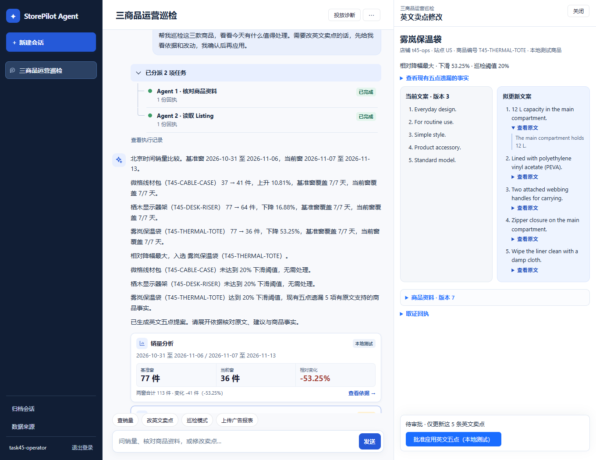

# StorePilot Agent

StorePilot 是跨境电商运营工作台。它关联订单销量、广告报表和版本化商品资料，帮助运营人员找到需要处理的 SKU、核对依据并生成待审建议。批准后，系统更新本地 Listing 并保存执行回执，供刷新、重试和下一周期复盘使用。

[项目截图和讲解](docs/SHOWCASE.md) · [架构](ARCHITECTURE.md) · [接口](API.md) · [部署](DEPLOY.md) · [变更日志](docs/CHANGELOG.md)



截图为隔离 SQLite 上的三商品巡检和待审五点。可以从 [项目展示](docs/SHOWCASE.md) 查看同一次操作的审批回执，以及广告复核与搜索词诊断。

## 可以做什么

| 业务任务 | Agent 的处理方式 |
| --- | --- |
| 查销量和巡检 | 在授权店站和 SKU 范围内比较日期窗，区分已覆盖日期的零销量与缺报。工作群订阅可响应订单发布或补报，后台完成巡检。 |
| 商品资料问答 | 按店铺、站点、SKU 和生效版本检索，回答带可点击的原文引用。多项问题分别核验证据，缺项会单独指出。 |
| Listing 五点和复盘 | 生成附原文的待审五点。服务端批准时重新核验权限、版本和依据，审批后读回实际版本，并从原回执查看下一周期销量。 |
| 广告搜索词诊断 | 上传 Sponsored Products 报表，核对样本、商品归属和资料，再建议改标题、复核投放或继续观察。标题草案支持校验与复制。 |
| 广告 CTR 独立复核 | 主 Agent 选择直查或临时派单。取证 Worker 可并行查询指标和规则，复核 Worker 等待已核验产物，工作台实时展示进度。 |

## 本地启动

服务入口是 [`fast_server.py`](fast_server.py)，由 Uvicorn 启动 `fast_server:app`。仓库内的 `uv.lock` 和 `locks/` 固定了依赖版本。下面用 Python 3.12 在 Windows PowerShell 启动隔离的本地模拟实例。

```powershell
py -3.12 -m venv .venv
$python = '.\.venv\Scripts\python.exe'
& $python -m pip --isolated install --require-hashes -r locks/acceptance.txt

$env:AD_OFFLINE_ACCEPTANCE = '1'
$env:APP_STARTUP_MODE = 'demo'
$env:DIAGNOSIS_MYSQL_ENABLED = '0'
$env:PYTHON_DOTENV_DISABLED = '1'
$env:LLM_PROVIDER = 'mock'
$env:JWT_SECRET = & $python -c "import secrets; print(secrets.token_urlsafe(32))"
$demoDir = New-Item -ItemType Directory -Path ("logs/local-demo-" + [guid]::NewGuid().ToString("N"))
$env:DIAGNOSIS_SANDBOX_DB_PATH = Join-Path $demoDir.FullName 'demo.sqlite3'
& $python -m uvicorn fast_server:app --host 127.0.0.1 --port 5010
```

看到 `http://127.0.0.1:5010/api/ready` 返回 HTTP 200 后，打开工作台。回环演示账号为 `zhangsan`，口令为 `user123`。这个实例初始化示例账号和日报。商品与审批演示由下节的验收脚本另外准备。真实模型、BGE 和后台消费者的配置见部署文档。[本地工作台](http://127.0.0.1:5010) · [部署手册](DEPLOY.md)

## 离线评测与浏览器演示

在仓库根目录，用 Node.js 22+（含 npm 10+）安装 Playwright 并复跑本地隔离验收。固定回放使用合成数据，可在无模型密钥和无 BGE 权重的环境运行。

```powershell
npm ci
$env:PLAYWRIGHT_BROWSERS_PATH = '0'
npm run browser:install
& .\.venv\Scripts\python.exe -B -X utf8 -m scripts.run_acceptance --mode core
& .\.venv\Scripts\python.exe -B -X utf8 -m scripts.verify_workbench --output-dir "logs/workbench-$(Get-Date -Format yyyyMMdd-HHmmss)"
```

浏览器演示生成销量、待审批、已执行和刷新读回记录。验收过程使用临时数据库和独立的运行目录。

## 验证范围

真实 GLM 与浏览器演示覆盖了广告复核中的动态派单，以及三商品巡检、人工审批和回执读回的正例。权限变更、事务回滚和后台续跑另有固定模型与隔离 SQLite 的回归。商品资料评测单独统计检索、引用和原文回查。[展示与工程证据](docs/SHOWCASE.md) · [商品资料评测](docs/product-evidence/README.md)

当前主要验证环境是本机 SQLite 与 WSL2 封闭容器。在公开演示中，销量来自 Olist 历史数据或合成订单，广告指标来自 Criteo 数据或报表夹具，商品改动写入本地测试库。真实 Amazon 报表、订单和平台写回待独立联调。[远程演示部署草案](docs/REMOTE_DEMO.md)

## 计划历史与可计算诊断

在需要复跑广告历史指标案例时，将 [Criteo 固定版本公开历史](https://huggingface.co/datasets/criteo/criteo-attribution-dataset/tree/904188a63cbad78bee43cd26ff5ee4ac77903986) 中的 `criteo_attribution_dataset.tsv.gz` 放在 `data/public/criteo/`，从仓库根目录执行以下命令。导入会生成只读指标产物，核验命令从原始数据独立复算。

```powershell
& .\.venv\Scripts\python.exe -m scripts.import_criteo_metrics data/public/criteo/criteo_attribution_dataset.tsv.gz
& .\.venv\Scripts\python.exe -m scripts.verify_criteo_metrics data/public/criteo/criteo_attribution_dataset.tsv.gz data/plan_metrics/criteo.sqlite3
& .\.venv\Scripts\python.exe -B -X utf8 -m scripts.run_acceptance --mode full
```

账户绑定见 [部署文档](DEPLOY.md#计划历史数据部署)。
