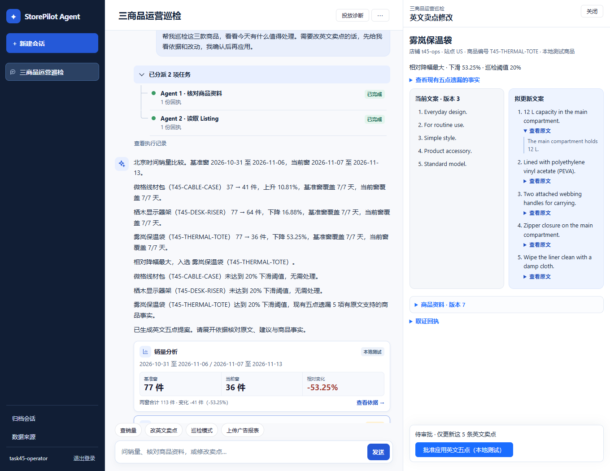
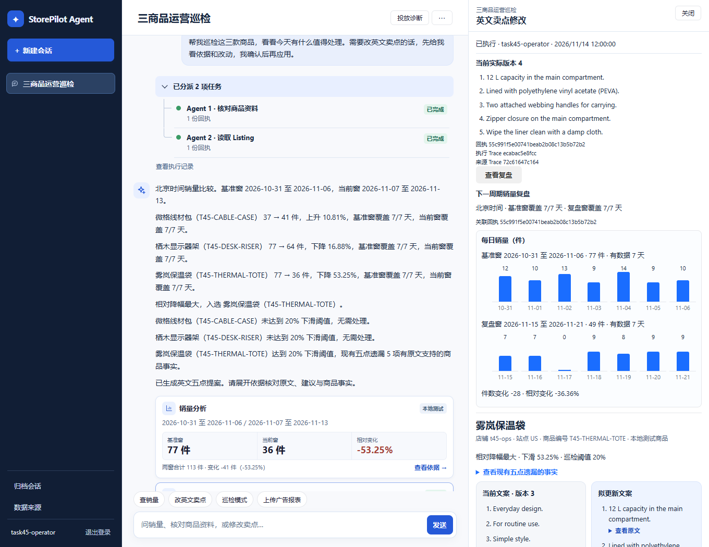
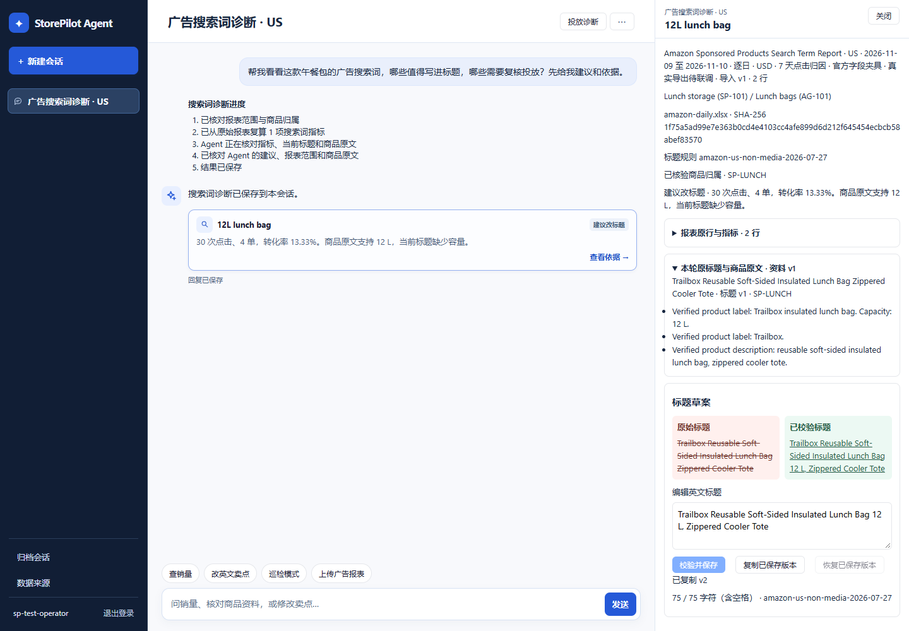
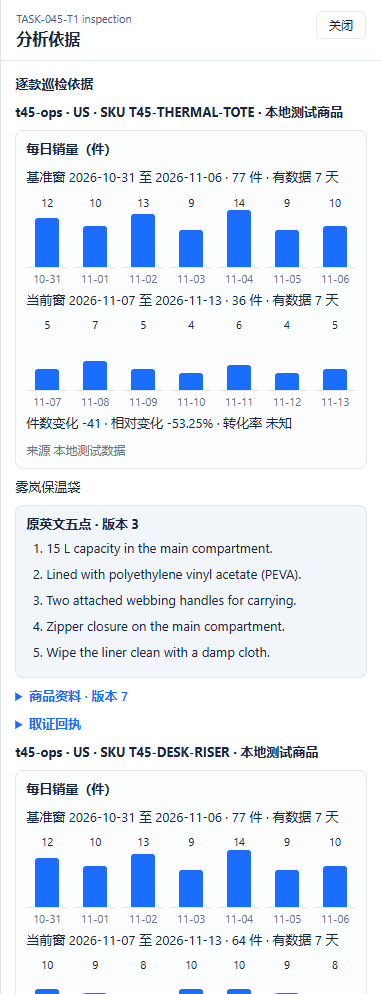

# StorePilot 项目展示

以下是 StorePilot 工作台的浏览器实拍及对账结果。商品改动在隔离测试库中执行，广告搜索词诊断使用按 Amazon 官方字段构造的报表夹具。

## 1. 三商品巡检、审批与复盘

用户发起三商品巡检。工作台比较相同的两个七日窗，选中销量从 77 降至 36 件的保温袋，并展示待审批的五条英文卖点。点开一条就能回查对应原文。换销量后入选对象随之改变，缺日报或关键事实时暂停生成提案。

审批前商品原样。批准后仅入选商品的五点被更新，版本从 3 升到 4。浏览器通过独立 GET、刷新和重复确认读回同一条回执。复盘从该回执打开，以原基准窗对比批准后七个完整日，销量从 77 件变为 49 件。

以上两图来自本地开发版本的 Edge 固定回放，使用隔离 SQLite。真实 GLM 正例也跑通了从巡检到复盘的流程，模型自主选择直查。

## 2. 主 Agent 如何派单与交接

图为新版工作台的真实 GLM 与 Edge 实拍。主 Agent 同批分派四项任务，两位 Agent 分别查 #101、#103 的两窗指标，一位检索指定版本规则。独立复核任务在对话内列出等待的 Agent，以及各自要交回的日期窗、曝光、点击、CTR 或规则原文。

同一轮的证据齐备后，页面显示「已接收 4 份指标、1 份规则」。复核 Agent 只读取入选计划 #103 的详情，结论下方可打开分析依据。实测用公开历史指标和沙箱计划，暂停建议仍待审批。

## 3. 广告搜索词诊断与标题草案

用户上传报表并确认商品归属。`12L lunch bag` 有 30 次点击和 4 单，商品原文支持 12 L，而原标题遗漏了容量。工作台展示建议、报表原行和新旧标题，允许编辑并复制校验通过的草案。图中是刷新后重新打开原卡、复制已保存的 **75 字符**草案。

同一测试词在 8 L 商品资料下转为投放复核，样本不足时继续观察，混合广告组缺逐行归属时只展示组级指标。旧草案可以回查，商品资料或原标题变化后会要求重新诊断才能编辑或复制。图片来自本地开发版本的 Edge 固定回放。报表为官方字段夹具，真实导出待联调。

## 4. 三款商品的上新前巡检

同一请求比较三款商品的两窗销量，再核对 Listing 与资料。交换两款商品的销量后，优先处理对象随证据变化。遇到事实缺项，报告缺少的属性。这个流程只读。截图来自固定回放，真实 GLM 两组对照各 8/8，实际都选择直查。

## 5. 网关与后台任务恢复

普通聊天断线时会取消本轮，并在 Worker 和在途工具退出后释放名额。用户明确选择「后台巡检」后，任务执行与进度订阅分开。浏览器断开后任务继续运行，重新订阅时按事件序号补读已提交的进度。进程退出时，另一执行者接管同一个 `run_id`，保留原名额和已提交检查点。

| 实验 | 实测结果 |
| --- | --- |
| **G0–G1 · 网关转发** | Edge 直连和经 Envoy 都在完成前显示 SSE 进度。审批已提交后截断响应，Envoy 返回 503，首次动作只有一次上游尝试。用原 `action_id` 独立 GET 及人工再确认，读回同一回执，SQL 只有一次版本更新。 |
| **G2 · 双入口与在途占用** | 甲占满两个名额后，乙仍能使用全局第三席。断流后先等工具退出和 Worker 回收，再释放原名额。混压时两组历史与回执 GET 均为 360/360，三轮 P95 变化方向不一致。 |
| **G3 · SSE 断线重连** | 浏览器在事件 3 后断开，后台提交事件 4。经另一 Envoy 带游标 3 重连，最终显示连续、无重复的 1–23 个事件，刷新读回同一答案。 |
| **G4 · 双进程抢占与接管** | 两个进程抢同一轮只有一个获准，不同轮实际可并行。事实检查点提交前终止进程，接管后事实底层读取累计 2 次。提交后再终止，接管复用原产物，事实只读 1 次。旧代次提交被拒，前后 SQL 一致。 |

G4 用两个同主机执行进程、共享隔离 SQLite、固定模型和只读三商品巡检验收。五轮的独立 SQL 和验收触发器均记录 **1 次助手答案插入、1 个最终事件、1 次名额释放**。在最终提交后立即终止进程的场景里，另一进程跳过已完成任务，独立 GET 和页面刷新返回同一个答案。

[后台巡检执行入口](../backend/agent/background_inspection.py) · [检查点与终态事务](../backend/database/background_inspections.py) · [故障验收脚本](../scripts/storepilot_g4.py)

Linux amd64 的 [Compose 脚本](../deploy/storepilot-gateway/run-matrix.sh)提供 G0–G1 复跑入口。上述网关矩阵在 QEMU Alpine 中实测。G2–G4 的 [QEMU 脚本](../deploy/storepilot-gateway/run-g2-qemu.ps1)需要本地准备的 GuestAssets、Edge 与锁定依赖，G3 录屏另需 Playwright FFmpeg。测试库和日志由脚本在复跑时生成。

[本地启动和验收命令](../README.md#本地启动) · [实现架构](../ARCHITECTURE.md) · [异地试用部署说明](REMOTE_DEMO.md)
