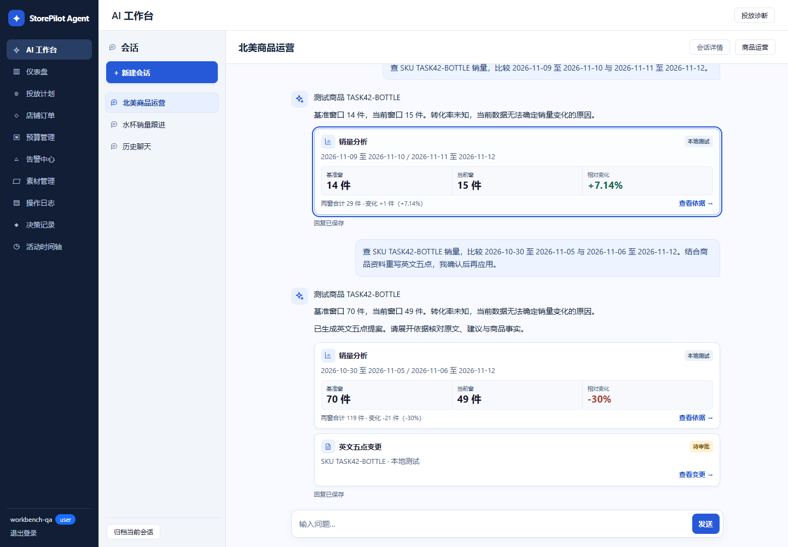
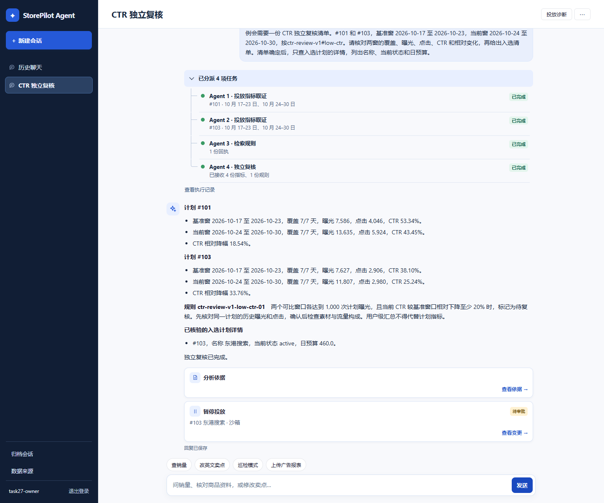

# StorePilot 项目展示

建议先看工作台中的商品运营闭环，再看广告复核中主 Agent 和 Worker 的交接。以下为 Edge 或 Chromium 浏览器实拍，分别注明使用的模型和数据。

## 1. 一句话查销量和起草英文五点

在已有会话询问商品销量，工作台显示前后两窗、数量和变化率。第二轮在同一会话里结合商品资料，生成待审批的英文五点。截图来自固定回放，使用隔离 SQLite 中的测试商品数据。

## 2. 主 Agent 如何派单与交接

主 Agent 让两位 Worker 分别查两条计划的指标，另一位检索指定版本规则。独立复核任务等三项证据就绪后才启动，页面显示它在等谁和等哪种产物。

复核 Worker 实际接收四份指标和一份规则，再读取入选计划详情。这是一轮真实 GLM 调用，使用公开历史指标和沙箱计划。执行记录可串起上游回执、下游首份模型输入与最终结论。页面上的暂停建议待审批。

## 3. 英文五点如何从草案变成实际修改

| 审批前 | 批准后刷新读回 |
| --- | --- |
|  |  |

真实 GLM 根据版本化商品事实生成英文五点。批准前版本为 3，商品内容无变化。批准后页面重新请求 GET，读回版本 4、实际五点和同一执行回执。独立 SQL 核对只有目标测试商品的五点和版本更新。

## 4. 三款商品的上新前巡检

同一请求比较三款商品的两窗销量，再核对 Listing 与资料。交换两款商品的销量后，优先处理对象随证据变化。遇到事实缺项，报告缺少的属性。这个流程只读。截图来自固定回放，真实 GLM 两组对照各 8/8，实际都选择直查。

## 5. 网关与后台任务恢复

普通聊天断线时会取消本轮，并在 Worker 和在途工具退出后释放名额。用户明确选择「后台巡检」后，任务执行与进度订阅分开。浏览器断开后任务继续运行，重新订阅时按事件序号补读已提交的进度。进程退出时，另一执行者接管同一个 `run_id`，保留原名额和已提交检查点。

| 实验 | 实测结果 |
| --- | --- |
| **G0–G1 · 网关转发** | Edge 直连和经 Envoy 都在完成前显示 SSE 进度。审批已提交后截断响应，Envoy 返回 503，首次动作只有一次上游尝试。用原 `action_id` 独立 GET 及人工再确认，读回同一回执，SQL 只有一次版本更新。 |
| **G2 · 双入口与在途占用** | 甲占满两个名额后，乙仍能使用全局第三席。断流后先等工具退出和 Worker 回收，再释放原名额。混压时两组历史与回执 GET 均为 360/360，三轮 P95 变化方向不一致。 |
| **G3 · SSE 断线重连** | 浏览器在事件 3 后断开，后台提交事件 4。经另一 Envoy 带游标 3 重连，最终显示连续、无重复的 1–23 个事件，刷新读回同一答案。 |
| **G4 · 双进程抢占与接管** | 两个进程抢同一轮只有一个获准，不同轮实际可并行。事实检查点提交前终止进程，接管后事实底层读取累计 2 次。提交后再终止，接管复用原产物，事实只读 1 次。旧代次提交被拒，前后 SQL 一致。 |

G4 用两个同主机执行进程、共享隔离 SQLite、固定模型和只读三商品巡检验收。五轮的独立 SQL 和验收触发器均记录 **1 次助手答案插入、1 个最终事件、1 次名额释放**。在最终提交后立即终止进程的场景里，另一进程跳过已完成任务，独立 GET 和页面刷新返回同一个答案。

[后台巡检执行入口](../backend/agent/background_inspection.py) · [检查点与终态事务](../backend/database/background_inspections.py) · [故障验收脚本](../scripts/storepilot_g4.py)

Linux amd64 的 [Compose 脚本](../deploy/storepilot-gateway/run-matrix.sh)提供 G0–G1 复跑入口。上述网关矩阵在 QEMU Alpine 中实测。G2–G4 的 [QEMU 脚本](../deploy/storepilot-gateway/run-g2-qemu.ps1)需要本地准备的 GuestAssets、Edge 与锁定依赖，G3 录屏另需 Playwright FFmpeg。测试库和日志由脚本在复跑时生成。

## 技术面试可以从三个问题讲起

1. **什么时候拆任务？** 用简单查销量与广告独立复核对照，解释并行取证与依赖等待，并说明以真实读取区间和 Worker 输入来验证协作。
2. **引用怎么可信？** 商品资料先解析店铺、站点、SKU 和生效版本，再从本轮授权候选逐项核验。缺项指出缺哪项，读原文时重新校验权限和版本。
3. **怎么证明改动真的发生？** 用审批前快照、审批后独立 GET、刷新回读和独立 SQL 交叉验证。提案携带版本与来源，回执和目标更新同一事务提交。

[本地启动和验收命令](../README.md#本地启动) · [实现架构](../ARCHITECTURE.md) · [异地试用部署说明](REMOTE_DEMO.md)
