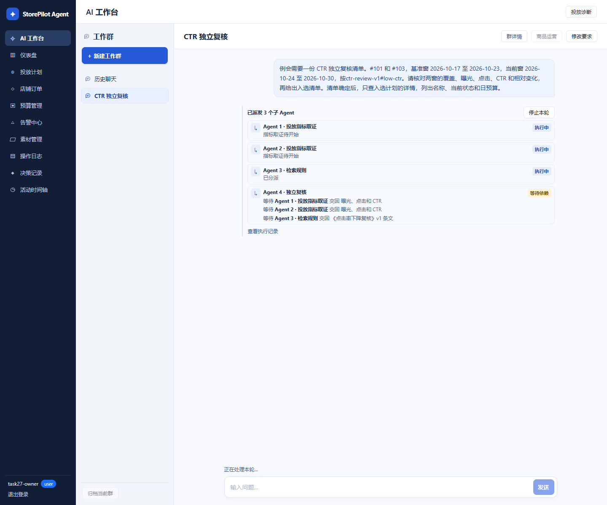
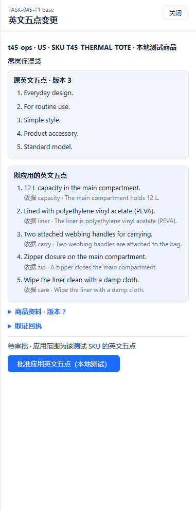
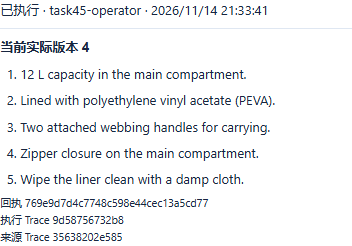

# StorePilot 项目展示

建议先看工作台中的商品运营闭环，再看广告复核中主 Agent 和 Worker 的交接。以下为 Edge 或 Chromium 浏览器实拍，分别注明使用的模型和数据。

## 1. 一句话查销量和起草英文五点

在已有会话询问商品销量，工作台显示前后两窗、数量和变化率。第二轮在同一会话里结合商品资料，生成待审批的英文五点。截图来自固定回放，使用隔离 SQLite 中的测试商品数据。

## 2. 主 Agent 如何派单与交接

主 Agent 让两位 Worker 分别查两条计划的指标，另一位检索指定版本规则。独立复核任务等三项证据就绪后才启动，页面显示它在等谁和等哪种产物。

复核 Worker 实际接收四份指标和一份规则，再读取入选计划详情。这是一轮真实 GLM 调用，使用公开历史指标和沙箱计划。执行记录可串起上游回执、下游首份模型输入与最终结论。页面上的暂停建议待审批。

## 3. 英文五点如何从草案变成实际修改

| 审批前 | 批准后刷新读回 |
| --- | --- |
|  |  |

真实 GLM 根据版本化商品事实生成英文五点。批准前版本为 3，商品内容无变化。批准后页面重新请求 GET，读回版本 4、实际五点和同一执行回执。独立 SQL 核对只有目标测试商品的五点和版本更新。

## 4. 三款商品的上新前巡检

同一请求比较三款商品的两窗销量，再核对 Listing 与资料。交换两款商品的销量后，优先处理对象随证据变化。遇到事实缺项，报告缺少的属性。这个流程只读。截图来自固定回放，真实 GLM 两组对照各 8/8，实际都选择直查。

## 技术面试可以从三个问题讲起

1. **什么时候拆任务？** 用简单查销量与广告独立复核对照，解释并行取证与依赖等待，并说明以真实读取区间和 Worker 输入来验证协作。
2. **引用怎么可信？** 商品资料先解析店铺、站点、SKU 和生效版本，再从本轮授权候选逐项核验。缺项指出缺哪项，读原文时重新校验权限和版本。
3. **怎么证明改动真的发生？** 用审批前快照、审批后独立 GET、刷新回读和独立 SQL 交叉验证。提案携带版本与来源，回执和目标更新同一事务提交。

[本地启动和验收命令](../README.md#本地启动) · [实现架构](../ARCHITECTURE.md) · [异地试用部署说明](REMOTE_DEMO.md)
